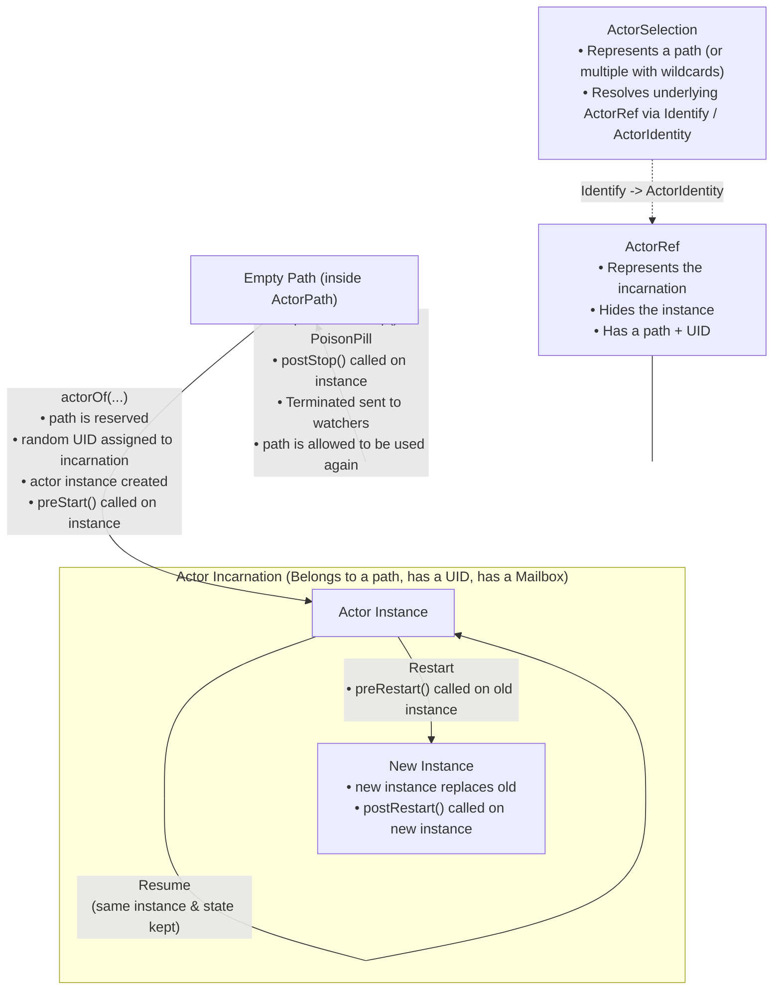
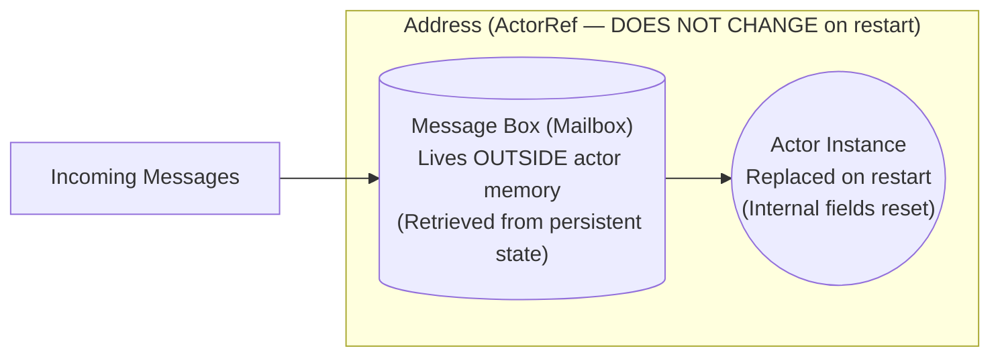

# Akka Classic & Actor Model — Complete Exam Notes & Cheat Sheet (NSDS)

> [!TIP]
> **Quick Navigation (Exam Index)**:
> - [0. Exam Code Templates (`akka-lab-template`) & Essential Snippets](#0-exam-code-templates--essential-snippets)
> - [1. Lecture 1 — Actor Model, Lifecycle, Mailbox & `become()`](#1-lecture-1--actor-model--akka-fundamentals)
> - [2. Lecture 2 — Communication Semantics, `Stash`, `Ask` Pattern & Remote Distribution](#2-lecture-2--communication-stash-ask-pattern--distribution)
> - [3. Lecture 3 — Fault Tolerance, Supervision Hierarchy & Clustering](#3-lecture-3--fault-tolerance-supervision--clustering)
> - [4. Lab 1 — Exercises & Pattern Reference (`base`, `ex1`, `ex2`, `ex3`)](#4-lab-1--exercises--pattern-reference)

---

## 0. Exam Code Templates & Essential Snippets

All ready-to-use, compilable templates are located in [`akka-lab-template/src/main/java/com/polimi/akka/template/`](file:///C:/Users/marco/Documents/GitHub/nsds-akka-local/akka-lab-template/src/main/java/com/polimi/akka/template):

| Exam Scenario / Pattern | Template File | Key Akka Classes & Methods |
| :--- | :--- | :--- |
| **Basic Actor, Predicate Matching & Lifecycle** | [`TemplateActor.java`](file:///C:/Users/marco/Documents/GitHub/nsds-akka-local/akka-lab-template/src/main/java/com/polimi/akka/template/TemplateActor.java) | `AbstractActor`, `createReceive()`, `.match(Class, Predicate, Handler)`, `sender().tell(reply, self())`, `preStart()`, `preRestart()`, `postRestart()`, `postStop()` |
| **Immutable Serializable Message** | [`TemplateMessage.java`](file:///C:/Users/marco/Documents/GitHub/nsds-akka-local/akka-lab-template/src/main/java/com/polimi/akka/template/TemplateMessage.java) | `implements Serializable`, `private final` fields, getters only |
| **Main Bootstrap, Thread Pool & `ask`** | [`MainTemplate.java`](file:///C:/Users/marco/Documents/GitHub/nsds-akka-local/akka-lab-template/src/main/java/com/polimi/akka/template/MainTemplate.java) | `ActorSystem.create()`, `sys.actorOf()`, `tell()`, `Executors.newFixedThreadPool()`, `Patterns.ask()`, `Await.result()` |
| **Dynamic Behavior / State Machine (`become`)** | [`StateMachineActorTemplate.java`](file:///C:/Users/marco/Documents/GitHub/nsds-akka-local/akka-lab-template/src/main/java/com/polimi/akka/template/StateMachineActorTemplate.java) | `getContext().become(nextReceiveBehavior())`, multiple `Receive` builders (`disabled()`, `enabled()`) |
| **Conditional Buffering (`stash` / `unstashAll`)** | [`StashActorTemplate.java`](file:///C:/Users/marco/Documents/GitHub/nsds-akka-local/akka-lab-template/src/main/java/com/polimi/akka/template/StashActorTemplate.java) | `AbstractActorWithStash`, `stash()`, `unstashAll()` |
| **Client-Server Request/Reply (Async vs Sync)** | [`RequestReplyTemplate.java`](file:///C:/Users/marco/Documents/GitHub/nsds-akka-local/akka-lab-template/src/main/java/com/polimi/akka/template/RequestReplyTemplate.java) | Workaround (`become` + `stash` + `unstashAll`) vs. `Patterns.ask()` + `Await.result()` |
| **Fault Tolerance & Supervision (`OneForOne` / `AllForOne`)** | [`SupervisionTemplate.java`](file:///C:/Users/marco/Documents/GitHub/nsds-akka-local/akka-lab-template/src/main/java/com/polimi/akka/template/SupervisionTemplate.java) | `OneForOneStrategy`, `AllForOneStrategy`, `DeciderBuilder`, `resume()`, `restart()`, `stop()`, `escalate()`, `getContext().actorOf(props)` |
| **Remote Distribution over TCP (`ActorSelection`)** | [`RemoteDistributionTemplate.java`](file:///C:/Users/marco/Documents/GitHub/nsds-akka-local/akka-lab-template/src/main/java/com/polimi/akka/template/RemoteDistributionTemplate.java) & [`remote.conf`](file:///C:/Users/marco/Documents/GitHub/nsds-akka-local/akka-lab-template/src/main/resources/remote.conf) | `ConfigFactory.parseFile()`, `ActorSystem.create("Server", conf)`, `getContext().actorSelection("akka.tcp://...")` |

### Fast Copy-Paste Snippets for the Exam

```java
// --- 1. ESSENTIAL IMPORTS ---
import akka.actor.*;
import akka.japi.pf.DeciderBuilder;
import akka.pattern.Patterns;
import scala.concurrent.Await;
import scala.concurrent.Future;
import java.io.Serializable;
import java.time.Duration;
import java.util.Optional;
import java.util.concurrent.TimeUnit;
import static akka.pattern.Patterns.ask;
import static java.util.concurrent.TimeUnit.SECONDS;

// --- 2. PROPS WITH & WITHOUT CONSTRUCTOR ARGUMENTS ---
public static Props props() {
    return Props.create(MyActor.class);
}
public static Props props(ActorRef target, int threshold) {
    return Props.create(MyActor.class, () -> new MyActor(target, threshold));
}

// --- 3. SEND, REPLY & FORWARD ---
// Asynchronous fire-and-forget from main (no sender):
target.tell(new MyMsg(), ActorRef.noSender());
// Asynchronous send from inside an actor:
target.tell(new MyMsg(), self());
// Reply to the sender of the current message:
sender().tell(new ReplyMsg(), self());
// Forward a message preserving the original sender():
target.tell(msg, sender()); // or: target.forward(msg, getContext());

// --- 4. SYNCHRONOUS ASK PATTERN (BOTH SLIDE VARIANTS) ---
// Variant A (Lecture 2 Slide 11 - Await.result):
Future<Object> future = Patterns.ask(receiver, msg, 5000);
ReplyMsg reply = (ReplyMsg) Await.result(future, scala.concurrent.duration.Duration.create(5, SECONDS));

// Variant B (Lecture 3 Slide 13 - future.result):
scala.concurrent.duration.Duration timeout = scala.concurrent.duration.Duration.create(5, SECONDS);
Future<Object> waitingForChild = ask(supervisor, Props.create(ChildActor.class), 5000);
ActorRef child = (ActorRef) waitingForChild.result(timeout, null);
```

---

## 1. Lecture 1 — Actor Model & Akka Fundamentals

### 1.1 Philosophy & Motivation (Slides 2–6)
- **"The world is parallel"** (Joe Armstrong, creator of Erlang): to write programs that behave like real-world objects, they must have a concurrent structure. Actor-oriented languages model how people think and interact in large organizations.
- **Why study the Actor Model?**
  1. **Alternative approach to concurrency** compared to shared-memory lock-based primitives (`synchronized`, mutexes, semaphores).
  2. **Low-level distribution awareness**: does **not** hide the complexities of building distributed applications, forcing developers to explicitly handle distribution concerns (message loss, latency, partial failures).
  3. **Blurs the distinction between local and remote processing**: the exact same message-passing abstraction works on a single machine or across a cluster.
  4. **Foundation for higher-level services**: streams, HTTP servers, sharding, and distributed data are built on top of actors.
- **Real-World Adoption**:
  - **Erlang**: Ericsson network infrastructure, WhatsApp backend, CouchDB, RabbitMQ.
  - **.NET Orleans**: Halo multiplayer backend.
  - **Java / Scala Akka**: BMW, VW Group, Bosch, Siemens, Volvo.

### 1.2 Definition & Properties of Actors (Slides 7–11)
- **Actor Model**: mathematical model of concurrent computation where the **actor is the universal primitive** of concurrent computation.
- **Core Properties of an Actor**:
  1. **Stateful**: maintains private internal state that cannot be accessed directly by any other actor.
  2. **Asynchronous**: actors run concurrently and communicate exclusively through **asynchronous message passing**.
  3. **Persistent**: internal state can optionally be saved to persistent storage to recover from crashes.
- **What can an actor do when it receives a message? (Only 3 actions)**:
  1. **Take local decisions**:
     - Change its private **internal state**.
     - Change its **behavior** for future messages (`getContext().become(...)`).
  2. **Send messages**:
     - Send $0, 1,$ or more messages to the `sender()` or to any other `ActorRef` it knows.
  3. **Start new actors**:
     - Spawn child actors (`getContext().actorOf(...)`), becoming their supervisor.
- **Fundamental Communication Principle**:
  - *"Do not communicate by sharing memory; instead, share memory by communicating."* (Effective Go)
  - Because actors share no memory, programs run in **distributed settings with no code changes** compared to a local setup, and the model makes **no assumptions on reliability or global message ordering**.

### 1.3 Shared Memory vs. Actor Model: Bank Account Example (Slides 12–13)
Suppose we want to implement a bank account whose balance must never become negative under concurrent access:

| Step / Aspect | Shared-Memory Model (Java Threads + Locks) | Actor Model (Akka) |
| :--- | :--- | :--- |
| **1. State representation** | Create an account object shared across threads. | Store the managed account inside the **private internal state** of an actor. |
| **2. Concurrency unit** | Explicitly create and manage threads for one or more accounts. | Creating a new actor **automatically makes it run asynchronously** with respect to all other actors. |
| **3. Concurrency control** | Manually add `synchronized` blocks or locks to prevent race conditions. | **No locks needed!** Messages are **processed atomically** (*"as if the entire processing of a message was executed in a `synchronized` method of a class where all methods are `synchronized`"*). |
| **Concurrent arrivals** | Threads block contending on locks. | Messages received while a handler is running are **queued in the actor's mailbox** and do not affect the currently running receive functionality. |

---

### 1.4 Akka Primitives, Actor Creation & Lifecycle (Slides 15–21)
- **Akka**: implementation of the actor model for the JVM (Java and Scala APIs), providing core actor primitives plus higher-level abstractions (*Akka Clusters, Akka Sharding, Akka Streams, Akka HTTP*).
- **Defining an Actor**:
  - Inherit from `AbstractActor` and implement `createReceive()`.
  - Optionally override lifecycle hooks: `preStart()`, `preRestart()`, `postRestart()`, `postStop()` (referred to as `preStop()` in Slide 16, `postStop()` in Slide 18 & Akka API).
- **Instantiating an Actor**:
  1. Create an `ActorSystem`: `ActorSystem sys = ActorSystem.create("sys name");`
  2. Create a `Props` configuration object (usually inside a static `props()` method of the actor class): `Props p = Props.create(MyActor.class);`
  3. Instantiate the actor via `actorOf`: `ActorRef ref = sys.actorOf(p, "actor name");`

#### Complete Actor Lifecycle & Addressing Diagram (Slide 18)



- **`ActorRef` vs. `ActorPath` vs. `ActorSelection`**:
  - **`ActorRef`**: immutable, serializable reference to an **actor incarnation** (path + random `UID`).
    - **Remains valid throughout the actor lifecycle**, even if the actor **restarts** (because a restart only replaces the underlying Java `Actor Instance` inside the same incarnation).
    - Can be **passed inside messages** to let other actors communicate with it.
    - Used to send messages via `tell(msg, senderRef)`.
  - **`ActorPath`**: hierarchical name in the system tree. Once an incarnation stops (`context.stop()` or `PoisonPill`), its path is freed and can be reused by a new incarnation (which gets a *different* `UID`).
  - **`ActorSelection`**: points to a path (possibly with wildcards) without a `UID`. Can resolve the current `ActorRef` by sending an `Identify` message and receiving `ActorIdentity`.

#### Slide 20–21 Code: Concurrent `CounterActor` & Multi-threaded `Counter`
```java
public class CounterActor extends AbstractActor {
    private int counter;

    public CounterActor() {
        this.counter = 0;
    }

    @Override
    public Receive createReceive() {
        return receiveBuilder()
                .match(SimpleMessage.class, this::onMessage)
                .build();
    }

    void onMessage(SimpleMessage message) {
        ++counter;
        System.out.println("Counter increased to: " + counter);
    }

    static Props props() {
        return Props.create(CounterActor.class);
    }
}

public class Counter {
    private static final int numThreads = 16;
    private static final int numMessages = 1000;

    public static void main(String[] args) throws InterruptedException, IOException {
        final ActorSystem sys = ActorSystem.create("System");
        final ActorRef counter = sys.actorOf(CounterActor.props(), "counter");

        // Send messages from multiple threads in parallel
        final ExecutorService exec = Executors.newFixedThreadPool(numThreads);
        for (int i = 0; i < numMessages; i++) {
            exec.submit(() -> counter.tell(new SimpleMessage(), ActorRef.noSender()));
        }
        // Wait for all messages to be sent and received
        System.in.read();
        exec.shutdown();
        sys.terminate();
    }
}
```

---

### 1.5 Mailbox Semantics, `become()` & Replying (Slides 22–26)

1. **Clause Matching Semantics (`createReceive()`)**:
   - When an actor processes a message from its mailbox, it checks all `.match(...)` clauses **in the exact order in which they are defined**.
   - It executes the handler associated with the **first matching clause**.
   - If **no matching clause exists**, the message is **discarded**.
2. **Mailbox Ordering Policy**:
   - Default mailbox policy is **FIFO**: messages are processed in the order they are enqueued in the mailbox.
   - **Single sender $\to$ receiver**: **FIFO order** is preserved (when using local memory or TCP).
   - **Different senders $\to$ receiver**: arrival order is **non-deterministic**.
3. **Message Immutability**:
   - **Messages MUST be immutable** (`private final` fields, no mutators).
   - This **cannot be statically checked or enforced by the Akka framework** in Java, but passing mutable objects causes race conditions and unexpected behavior when accessed by sender and receiver concurrently.
4. **Dynamic Behavior Switching (`getContext().become()`)**:
   - An actor can dynamically change its receiving behavior at runtime by calling `getContext().become(newReceive)` where `newReceive` is a `Receive` object with a new set of `match` clauses (Slide 24–25 `AlarmActor`, see [`StateMachineActorTemplate.java`](file:///C:/Users/marco/Documents/GitHub/nsds-akka-local/akka-lab-template/src/main/java/com/polimi/akka/template/StateMachineActorTemplate.java)).
5. **Replying to Messages (Slide 26)**:
   - `self()`: returns the `ActorRef` of the currently executing actor.
   - `sender()`: returns the `ActorRef` of the actor that sent the message currently being processed.
   - To reply to the sender:
     ```java
     sender().tell(msg, self());
     ```

---

## 2. Lecture 2 — Communication, Stash, Ask Pattern & Distribution

### 2.1 Communication Semantics & Best-Effort Philosophy (Slides 4–8)
- **No Mediating Entity**:
  - Unlike channel-based models (e.g., Go channels, CSP) where channels mediate communication and can enforce custom semantics (unidirectional vs. bidirectional, reliable vs. lossy, bounded buffers, ordering), actor communication is **direct point-to-point** via actor addresses.
- **Best-Effort Delivery**:
  - **At-most-once delivery**: no duplicate deliveries by the runtime, but **messages can be lost**.
  - **No global ordering guarantees**: in Akka, **FIFO order between any sender-receiver pair** holds only when using TCP (or local JVM delivery).
- **Why Best-Effort? ("Less is more", Slides 6–7)**:
  - In distributed systems, offering stronger guarantees at the transport layer is fundamentally limited: **IP is best-effort**, and **TCP cannot mask network partitions**.
  - Best-effort **forces developers to reason about the worst case**, resulting in applications that are robust both on a single machine and across multiple machines.
  - Stronger guarantees (e.g., exactly-once, causal/total broadcast, end-to-end acknowledgments) are **expensive** and **not always necessary**; when needed, developers can **implement them on top of the basic programming model**.
- **Addresses & Location Transparency (Slide 8)**:
  - Every actor is identified by an **address** that abstracts away physical location and network configuration.
  - A developer does not need to know whether the target actor runs on the **same machine**, in the **same cluster**, or at a **geographically remote site**.
  - **Many-to-many mapping between addresses and actors**:
    - **1 address $\to$ multiple actors**: used for load balancing (routers), replication, or proxying.
    - **1 actor $\to$ multiple addresses**: a single actor can be reachable through more than one logical address.

---

### 2.2 Stash (`AbstractActorWithStash`, Slide 9)
- Sometimes an actor receives a message that **cannot be processed in its current state or behavior**, but should be processed later rather than discarded.
- **How to use Stash**:
  1. Inherit from **`AbstractActorWithStash`** (instead of `AbstractActor`).
  2. Call **`stash()`** inside a message handler to save the current message into the actor's private stash buffer.
  3. Call **`unstashAll()`** when transitioning to a new state/behavior: this extracts **all** stashed messages **in the same order in which they were added (FIFO)** and **prepends them to the actor's mailbox** ahead of ordinary incoming messages.
  - Full template: [`StashActorTemplate.java`](file:///C:/Users/marco/Documents/GitHub/nsds-akka-local/akka-lab-template/src/main/java/com/polimi/akka/template/StashActorTemplate.java).

---

### 2.3 Waiting for a Reply: Workaround vs. `Ask` Pattern (Slides 10–11)

Because `tell()` is asynchronous, the sender does not automatically block waiting for a reply. When an actor needs to wait for a specific reply before processing subsequent messages, Akka offers two approaches (both implemented side-by-side in [`RequestReplyTemplate.java`](file:///C:/Users/marco/Documents/GitHub/nsds-akka-local/akka-lab-template/src/main/java/com/polimi/akka/template/RequestReplyTemplate.java)):

| Feature | Approach 1: Workaround (`become` + `stash`) — Slide 10 | Approach 2: `Ask` Pattern (`Patterns.ask` + `Await.result`) — Slide 11 |
| :--- | :--- | :--- |
| **Actor Base Class** | `AbstractActorWithStash` | `AbstractActor` |
| **Concurrency Model** | **Non-blocking / Asynchronous** (does not block any thread). | **Blocking / Synchronous** (blocks the current thread until reply or timeout). |
| **Step-by-Step Flow** | 1. Send request with `server.tell(req, self())`.<br>2. Switch behavior via `getContext().become(waitingForReply())`.<br>3. In `waitingForReply()`, match only the expected `ReplyMsg` and call `stash()` on all other messages (`.matchAny(msg -> stash())`).<br>4. When `ReplyMsg` arrives, process it, call `unstashAll()`, and revert to normal behavior via `getContext().become(normal())`. | 1. Send request via `Future<Object> future = Patterns.ask(receiver, msg, timeout)`.<br>2. Receiver replies normally via `sender().tell(reply, self())`.<br>3. Block on the future using `Await.result(future, timeout)` to extract the reply synchronously. |
| **Pros & Cons** | **Pro**: Fully non-blocking and scalable.<br>**Con**: Requires extra state-machine boilerplate (`become` + `stash`). | **Pro**: Concise, sequential code flow.<br>**Con**: Blocks a dispatcher thread; risk of thread-pool starvation if overused inside actors. |

---

### 2.4 Transparent Remote Distribution over TCP (Slides 13–17)
Actors can be distributed across multiple machines **transparently**:
- You only need the **remote address** of an actor to exchange messages with it as if it were local.
- Even **`ActorRef`s passed inside messages** are transparently serialized and propagated so actors on any remote machine can communicate directly.

#### 3 Steps to Distribute a Client/Server Application (Slides 15–17):
1. **Configuration file (`conf` / [`remote.conf`](file:///C:/Users/marco/Documents/GitHub/nsds-akka-local/akka-lab-template/src/main/resources/remote.conf))**:
   ```hocon
   akka {
     actor {
       provider = remote
     }
     remote {
       enabled-transports = ["akka.remote.netty.tcp"]
       netty.tcp {
         hostname = "127.0.0.1"
         port = 6123
       }
     }
   }
   ```
2. **Server `main` (Slide 16)**:
   ```java
   public static void main(String[] args) {
       Config conf = ConfigFactory.parseFile(new File("conf"));
       ActorSystem sys = ActorSystem.create("Server", conf);
       sys.actorOf(ServerActor.props(), "serverActor");
   }
   ```
3. **Client Actor Lookup via `ActorSelection` (Slide 17)**:
   ```java
   String serverAddr = "akka.tcp://Server@127.0.0.1:6123/user/serverActor";
   ActorSelection server = getContext().actorSelection(serverAddr);
   // ...and everything else (server.tell(msg, self())) remains the same!
   ```

---

## 3. Lecture 3 — Fault Tolerance, Supervision & Clustering

### 3.1 Supervision Hierarchy & Hierarchies of Responsibility (Slides 4–10)
- **Supervision Pattern**:
  - Faults and exceptions in Akka are managed through **supervision**.
  - **Every actor has a supervisor** that monitors its execution state—and that supervisor is simply **its parent actor** (the actor that created it via `getContext().actorOf(...)` and can stop it via `getContext().stop(...)`).
  - Applications are organized into **supervision trees**:
    - Each supervisor knows how to handle failures in its **directly supervised children**.
    - If a supervisor cannot handle a problem locally, it **escalates** (propagates) the fault to its own parent in the upper layer.
    - At the top of the hierarchy sit standard root/user supervisors provided by the Akka framework.
- **Design Rule — Hierarchy of Responsibility (Slide 6 & 9)**:
  - **Delegate risk downward**: if an actor contains **important state/data that must not be lost**, make it a **supervisor actor** and offload any potentially dangerous/faulty subtask to **child actors**.
  - **Homogeneous children**: a supervisor strategy in Akka depends on the **exception type** and **error frequency**, **independent of which specific child failed**. Therefore, an actor should normally supervise children of the **same type** (providing the same or similar functionality).
  - *"Philosophy: if you need more flexibility, build a deeper hierarchy!"*

#### What Happens When an Actor Restarts? (Slide 7)

- When a supervised actor is **restarted**:
  1. **Its address (`ActorRef`) does NOT change**: other actors can keep sending messages to the same reference.
  2. **Its mailbox is preserved**: the message box lives **outside of the actor memory** and is retained across restarts, so pending messages are not lost (note: the single message that caused the exception is consumed and not re-processed unless explicitly re-sent in `preRestart`).
  3. **Its internal state is reset** (a fresh Java object is instantiated), unless state was saved to persistent storage or the supervisor chose `resume()` instead of `restart()`.

---

### 3.2 Supervision Strategies & Directives (Slides 9–13)

| Supervision Strategy | Behavior |
| :--- | :--- |
| **`OneForOneStrategy`** *(One-for-one)* | Applies the fault directive **only to the single child that failed**. |
| **`AllForOneStrategy`** *(One-for-all)* | Applies the fault directive to **the failed child AND all its sibling children** under the same supervisor. |

| Fault Directive (`SupervisorStrategy.*`) | Effect on Child Actor | Effect on Internal State | Effect on `ActorRef` & Mailbox |
| :--- | :--- | :--- | :--- |
| **`resume()`** | Keeps the **same actor instance** running. | **Preserved** (kept as-is). | Unchanged; continues processing next message. |
| **`restart()`** | Calls `preRestart()` on old instance, replaces it with a **new instance**, calls `postRestart()`. | **Reset** to initial constructor values. | `ActorRef` and queued mailbox messages are **preserved**. |
| **`stop()`** | Permanently terminates the child actor (`postStop()` is called). | **Destroyed**. | Path freed; future messages go to `deadLetters`. |
| **`escalate()`** | Supervisor fails with the same exception and **propagates the fault up to its own parent**. | Depends on grandparent's decision. | If grandparent restarts the supervisor, its children are also restarted by default. |

#### Complete Supervision Code Example (Slides 11–13)
See full runnable class in [`SupervisionTemplate.java`](file:///C:/Users/marco/Documents/GitHub/nsds-akka-local/akka-lab-template/src/main/java/com/polimi/akka/template/SupervisionTemplate.java):
```java
// Slide 11: Supervisor Actor
public class CounterSupervisorActor extends AbstractActor {
    private static SupervisorStrategy strategy =
        new OneForOneStrategy(
            10,                     // maxNrOfRetries (10 faults)
            Duration.ofMinutes(1),  // withinTimeRange (within 1 minute; if exceeded -> stop!)
            DeciderBuilder.match(Exception.class, e ->
                SupervisorStrategy.restart())
            .build());

    @Override
    public SupervisorStrategy supervisorStrategy() {
        return strategy;
    }

    @Override
    public Receive createReceive() {
        return receiveBuilder()
            .match(Props.class, props -> {
                sender().tell(getContext().actorOf(props), self());
            })
            .build();
    }

    static Props props() {
        return Props.create(CounterSupervisorActor.class);
    }
}

// Slide 12: Supervised Child Actor
public class CounterActor extends AbstractActor {
    private int counter = 0;
    ...
    void onMessage(DataMessage msg) throws Exception {
        if (msg.getCode() == Counter.NORMAL_OP) {
            System.out.println("I am executing a NORMAL operation...counter is now " + (++counter));
        } else if (msg.getCode() == Counter.FAULT_OP) {
            System.out.println("I am emulating a FAULT!");
            throw new Exception("Actor fault!");
        }
    }

    @Override
    public void preRestart(Throwable reason, Optional<Object> message) {
        System.out.print("Preparing to restart...");
    }

    @Override
    public void postRestart(Throwable reason) {
        System.out.println("...now restarted!");
    }

    static Props props() {
        return Props.create(CounterActor.class);
    }
}

// Slide 13: Main Class
public class CounterSupervisor {
    public static final int NORMAL_OP = 0;
    public static final int FAULT_OP = -1;
    public static final int FAULTS = 1;

    public static void main(String[] args) {
        scala.concurrent.duration.Duration timeout =
            scala.concurrent.duration.Duration.create(5, SECONDS);

        final ActorSystem sys = ActorSystem.create("System");
        final ActorRef supervisor = sys.actorOf(CounterSupervisorActor.props(), "supervisor");

        ActorRef counter;
        try {
            scala.concurrent.Future<Object> waitingForCounter =
                ask(supervisor, Props.create(CounterActor.class), 5000);
            counter = (ActorRef) waitingForCounter.result(timeout, null);

            counter.tell(new DataMessage(NORMAL_OP), ActorRef.noSender());
            for (int i = 0; i < FAULTS; i++)
                counter.tell(new DataMessage(FAULT_OP), ActorRef.noSender());
            counter.tell(new DataMessage(NORMAL_OP), ActorRef.noSender());

            sys.terminate();
        } catch (Exception e) { ... }
    }
}
```
> [!WARNING]
> **Exam Trap on `OneForOneStrategy(maxNrOfRetries, withinTimeRange, decider)`**:
> In the example above, `maxNrOfRetries = 10` within `1 minute`. If `FAULTS` is `1`, the child restarts after the fault and the second `NORMAL_OP` prints `counter is now 1` (reset from `1` back to `0`, then incremented to `1`). If a child throws **more than 10 exceptions within 1 minute**, the supervisor stops restarting it and **terminates (`stop()`) the child**!

---

### 3.3 Akka Clustering (Slides 14–20)

- **What is Akka Clustering?**
  - A **decentralized, peer-to-peer membership service** with **no single point of failure (SPOF) and no single bottleneck**.
  - Built on a **gossip protocol** with **automatic failure detection**.
- **Core Terminology (Slide 15–16)**:
  - **Node**: a logical member of a cluster (you can think of a node as a process / `ActorSystem`).
    - Multiple nodes can run on the same physical machine.
    - Identified by a 3-tuple: **`hostname:port:uid`**.
  - **Cluster**: a set of nodes joined together through the membership service.
    - **Decoupling**: cluster membership and the actors running on a member node are **decoupled** (a node can be a member of a cluster while hosting $0, 1,$ or any number of actors).
    - A node joins a cluster by sending a **`join` command** to one of the existing nodes in the cluster.
  - **Leader**: a special **role** assumed by a single node in the cluster that **manages cluster convergence** (and membership state transitions). Any node can become leader if the current leader leaves.
- **Clustering Protocol & Gossip Convergence (Slides 17–18)**:
  - Nodes organize into an **overlay network** and exchange **gossip messages** containing their current view of the cluster membership.
  - Gossip messages carry **vector clocks** to record a **partial order of events** (nodes joining, leaving, etc.) observed in the environment, ensuring that node states **eventually converge**.
  - **Gossip Convergence**:
    - Information about the cluster **converges at a given node** when that node can prove that the cluster state it is observing **is seen the same by all other nodes** in the cluster.
    - **Crucial Rule**: **Gossip convergence CANNOT occur while any node is `"unreachable"`** (a lifecycle state indicating it is not currently possible to communicate with that node).
    - For convergence to resume, the unreachable node must either **become reachable again** or **be removed from the cluster** (downed).
- **Seed Nodes (Slide 19)**:
  - Configured contact points for new nodes that want to join the cluster.
  - When a new node wants to join:
    1. It **contacts all configured seed nodes** (at least one seed node must be active).
    2. It sends a **`join` command to the FIRST seed node that answers**.
- **Higher-Level Cluster Tools (Slide 20)**:
  1. **Cluster Singleton**: ensures that **only a single actor of a certain type** exists across the entire cluster (automatically migrated if its host node fails).
  2. **Cluster Sharding**: distributes actors across nodes of the cluster and ensures they can **communicate without knowing their physical location** (logical ID routing + automatic rebalancing).
  3. **Distributed Data**: creates a **distributed key-value store** across the nodes of the cluster (using Conflict-Free Replicated Data Types / CRDTs).
  4. **Cluster Metrics**: publishes and collects **health and load metrics** (CPU, heap, system load) about cluster members for adaptive load balancing.

---

## 4. Lab 1 — Exercises & Pattern Reference

All Lab 1 solutions are located in [`lab1-solutions/src/main/java/com/polimi/nsds/akka/`](file:///C:/Users/marco/Documents/GitHub/nsds-akka-local/lab1-solutions/src/main/java/com/polimi/nsds/akka):

### 4.1 Class-Based Matching vs. Predicate Selectors (`ex1`)
| Criterion | Separate Classes ([`ex1/classes`](file:///C:/Users/marco/Documents/GitHub/nsds-akka-local/lab1-solutions/src/main/java/com/polimi/nsds/akka/ex1/classes/CounterActor.java)) | Predicate Selectors ([`ex1/selectors`](file:///C:/Users/marco/Documents/GitHub/nsds-akka-local/lab1-solutions/src/main/java/com/polimi/nsds/akka/ex1/selectors/CounterActor.java)) |
| :--- | :--- | :--- |
| **`createReceive()` syntax** | `.match(IncrementMsg.class, this::onInc)`<br>`.match(DecrementMsg.class, this::onDec)` | `.match(CounterMsg.class, m -> m.getOp() == INC, this::onInc)`<br>`.match(CounterMsg.class, m -> m.getOp() == DEC, this::onDec)` |
| **When to use in an exam** | Default choice when commands have **different payload fields** (e.g., `PutMsg(name, email)` vs. `GetMsg(name)`). | Best choice when routing depends on a **value/condition** inside the message (e.g., `msg.getCode() == FAULT_OP`, `msg.getAmount() > 0`). |

### 4.2 Non-Negative Counter with Stash (`ex2`)
- **Problem**: Counter starts at `0` and cannot become negative. Input sequence: `Dec1, Dec2, Inc1, Dec3, Inc2, Inc3`.
- **Implementation ([`ex2/CounterActor.java`](file:///C:/Users/marco/Documents/GitHub/nsds-akka-local/lab1-solutions/src/main/java/com/polimi/nsds/akka/ex2/CounterActor.java))**:
  - Extends `AbstractActorWithStash`.
  - On `DecrementMsg`: if `counter > 0`, `--counter`; else `stash()`.
  - On `IncrementMsg`: `++counter`, then `unstashAll()`.
- **Exact State Evolution (`1, 0, 1, 0, 1, 0`)**:
  1. `Dec1` $\to$ `counter == 0` $\to$ `stash()`. Stash: `[Dec1]`.
  2. `Dec2` $\to$ `counter == 0` $\to$ `stash()`. Stash: `[Dec1, Dec2]`.
  3. `Inc1` $\to$ `counter = 1` (**prints 1**), calls `unstashAll()` $\to$ `[Dec1, Dec2]` prepended to front of mailbox.
  4. `Dec1` (from mailbox) $\to$ `counter = 0` (**prints 0**).
  5. `Dec2` (from mailbox) $\to$ `counter == 0` $\to$ `stash()`. Stash: `[Dec2]`.
  6. `Dec3` $\to$ `counter == 0` $\to$ `stash()`. Stash: `[Dec2, Dec3]`.
  7. `Inc2` $\to$ `counter = 1` (**prints 1**), calls `unstashAll()` $\to$ `[Dec2, Dec3]` prepended to front of mailbox.
  8. `Dec2` (from mailbox) $\to$ `counter = 0` (**prints 0**).
  9. `Dec3` (from mailbox) $\to$ `counter == 0` $\to$ `stash()`. Stash: `[Dec3]`.
  10. `Inc3` $\to$ `counter = 1` (**prints 1**), calls `unstashAll()` $\to$ `[Dec3]` prepended to front of mailbox.
  11. `Dec3` (from mailbox) $\to$ `counter = 0` (**prints 0**).

### 4.3 Client/Server Contact Directory (`ex3`)
- [`ServerActor.java`](file:///C:/Users/marco/Documents/GitHub/nsds-akka-local/lab1-solutions/src/main/java/com/polimi/nsds/akka/ex3/ServerActor.java): stores contacts in a plain `HashMap<String, String>` (no `ConcurrentHashMap` needed), handles `PutMsg` and `GetMsg`, replies via `sender().tell(new ReplyMsg(...), self())`.
- [`ClientActor.java`](file:///C:/Users/marco/Documents/GitHub/nsds-akka-local/lab1-solutions/src/main/java/com/polimi/nsds/akka/ex3/ClientActor.java): non-blocking client using `become(waitingForReply())` + `stash()` + `unstashAll()`.
- [`ClientAskActor.java`](file:///C:/Users/marco/Documents/GitHub/nsds-akka-local/lab1-solutions/src/main/java/com/polimi/nsds/akka/ex3/ClientAskActor.java): synchronous client using `Patterns.ask(server, msg, TIMEOUT_MS)` + `Await.result(future, timeout)`.
