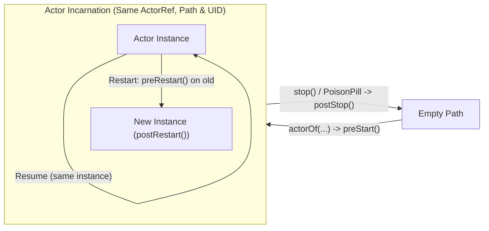
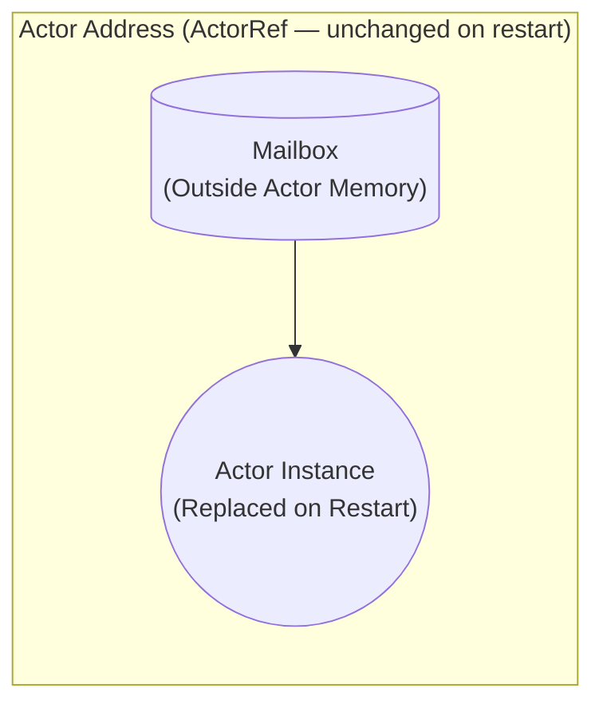

# Akka & Actor Model — Complete Lecture & Lab Notes (NSDS)

> [!TIP]
> **Quick Navigation**:
> 1. [Lecture 1 — Fundamentals, Lifecycle, Mailbox & `become()`](#1-lecture-1--actor-model--akka-fundamentals)
> 2. [Lecture 2 — Communication Semantics, `Stash`, `Ask` Pattern & Distribution](#2-lecture-2--communication-stash-ask-pattern--distribution)
> 3. [Lecture 3 — Fault Tolerance, Supervision & Clustering](#3-lecture-3--fault-tolerance-supervision--clustering)
> 4. [Lab 1 — Exercises & Code Cheat Sheet (`base`, `ex1`, `ex2`, `ex3`)](#4-lab-1--exercises--code-cheat-sheet)

---

## 1. Lecture 1 — Actor Model & Akka Fundamentals

### 1.1 Core Philosophy & Properties
- **"The world is parallel"** (Joe Armstrong, Erlang creator): modeling concurrent systems as independent communicating entities matches how the real world works.
- **"Do not communicate by sharing memory; instead, share memory by communicating"** (Effective Go): since actors share no memory, the same program structure works both **locally** and in **distributed settings**.
- **What is an Actor?** The universal primitive of concurrent computation.
  - **Stateful**: maintains private internal state that no other actor/thread can access directly.
  - **Asynchronous**: runs concurrently with other actors and communicates exclusively via asynchronous message passing.
  - **Persistent**: state can optionally be saved to persistent storage.
- **When an actor receives a message, it can only do 3 things**:
  1. **Take local decisions**: modify its private internal state or **change its behavior** for future messages.
  2. **Send messages**: send $0, 1,$ or more messages to the `sender()` or to other `ActorRef`s it knows.
  3. **Start new actors**: spawn child actors (`getContext().actorOf(...)`).

### 1.2 Shared Memory vs. Actor Model (Bank Account Example)

| Concern | Shared-Memory Model (Threads + Locks) | Actor Model (Akka) |
| :--- | :--- | :--- |
| **Concurrency unit** | Explicitly create threads to manage one or more accounts. | Creating a new actor automatically makes it run asynchronously. |
| **State protection** | Developer must add `synchronized` blocks, locks, or atomics. | **No locks needed**: private state is only modified inside message handlers. |
| **Atomicity guarantee** | Manual critical sections; prone to race conditions & deadlocks. | **Messages are processed atomically** (*"as if the entire processing of a message was executed in a `synchronized` method of a class where all methods are `synchronized`"*). |
| **Concurrent arrivals** | Threads contend on locks. | Messages arriving meanwhile are **queued in the mailbox** and never interfere with the currently running handler. |

---

### 1.3 Akka Primitives Cheat Sheet

```java
// 1. Define an Actor
public class CounterActor extends AbstractActor {
    private int counter = 0; // Private state (never shared!)

    @Override
    public Receive createReceive() {
        return receiveBuilder()
                .match(SimpleMessage.class, this::onMessage)
                .build();
    }

    void onMessage(SimpleMessage message) {
        ++counter; // Safe without locks!
        System.out.println("Counter increased to: " + counter);
    }

    static Props props() {
        return Props.create(CounterActor.class);
    }
}

// 2. Create ActorSystem, Instantiate Actor & Send Messages
final ActorSystem sys = ActorSystem.create("System");
final ActorRef counter = sys.actorOf(CounterActor.props(), "counter");
counter.tell(new SimpleMessage(), ActorRef.noSender()); // Asynchronous fire-and-forget
```

| Primitive / Method | Purpose |
| :--- | :--- |
| `AbstractActor` | Base class for standard Akka Classic actors. Requires implementing `createReceive()`. |
| `Props.create(MyActor.class, args...)` | Configuration/recipe object defining the actor class and constructor parameters. Usually wrapped in a `static Props props()` factory method. |
| `ActorSystem.create("Name")` | Heavyweight runtime container managing dispatchers, thread pools, and top-level actors. |
| `sys.actorOf(props, "name")` | Instantiates a top-level actor (`akka://System/user/name`) and returns its `ActorRef`. |
| `ActorRef` | Immutable, serializable handle to an actor. **Remains valid across actor restarts** and can be sent inside messages. |
| `target.tell(msg, senderRef)` | Sends `msg` asynchronously without blocking. Pass `self()` from inside an actor, or `ActorRef.noSender()` if no reply is expected. |
| `self()` / `sender()` | Inside a message handler: `self()` returns this actor's `ActorRef`; `sender()` returns the `ActorRef` of the sender of the currently processed message. |
| `sender().tell(reply, self())` | Standard idiom to reply to the sender of the current message. |

---

### 1.4 Actor Lifecycle & Addressing Concepts



- **Lifecycle Hooks (overridable in `AbstractActor`)**:
  - `preStart()`: called right after the actor instance is created, before processing its first message.
  - `preRestart(Throwable reason, Optional<Object> message)`: called on the **old** crashing instance before restart.
  - `postRestart(Throwable reason)`: called on the **new** replacement instance after restart.
  - `postStop()`: called after the actor has stopped; its path is freed and `Terminated` is sent to watchers.
- **`ActorPath` vs. `ActorRef` vs. `ActorSelection`**:
  - **`ActorPath`**: hierarchical name/path (like a file path). Can be reused after an actor stops.
  - **`ActorRef`**: points to a specific **incarnation** (path + random `UID`). Hides the underlying Java instance; survives restarts (`new` instance replaces `old` instance inside the same incarnation).
  - **`ActorSelection`**: represents a path (or wildcard path) used to look up actors dynamically by address (e.g., remote actors).

---

### 1.5 Mailbox Semantics & Dynamic Behavior (`become`)

> [!IMPORTANT]
> **3 Golden Rules of the Akka Mailbox**:
> 1. **Clause Evaluation Order**: `createReceive()` checks `.match(...)` clauses **top-to-bottom in definition order** and executes the **first matching clause**. If **no clause matches**, the message is **silently discarded**.
> 2. **Ordering Guarantees**: Default mailbox policy is **FIFO**.
>    - **Single sender $\to$ receiver**: **FIFO order** is guaranteed (if TCP or local delivery is used).
>    - **Multiple senders $\to$ receiver**: interleaving order is **non-deterministic**.
> 3. **Immutability**: Messages **must be immutable** (`final` fields, no setters). The compiler/framework **cannot enforce** this statically, but mutable messages break actor isolation and cause data races!

#### Dynamic Behavior Switching (`getContext().become()`)
An actor can change how it reacts to future messages at runtime by passing a new `Receive` object to `getContext().become(...)` (State Machine pattern):

```java
public class AlarmActor extends AbstractActor {
    @Override
    public Receive createReceive() {
        return disabled(); // Initial state
    }

    private final Receive enabled() {
        return receiveBuilder()
                .match(TriggerMsg.class, this::onTrigger)
                .match(DeactivateMsg.class, this::onDeactivate)
                .build();
    }

    private final Receive disabled() {
        return receiveBuilder()
                .match(ActivateMsg.class, this::onActivate)
                .build(); // TriggerMsg arriving while disabled matches nothing -> discarded!
    }

    private void onTrigger(TriggerMsg msg) { System.out.println("Alarm!!!!"); }

    private void onActivate(ActivateMsg msg) {
        System.out.println("Becoming enabled");
        getContext().become(enabled());
    }

    private void onDeactivate(DeactivateMsg msg) {
        System.out.println("Becoming disabled");
        getContext().become(disabled());
    }
}
```

---

## 2. Lecture 2 — Communication, Stash, Ask Pattern & Distribution

### 2.1 Best-Effort Communication Model
- **No mediating channel**: actors send directly to addresses (`ActorRef` / `ActorSelection`), unlike channel-based models (e.g., Go channels).
- **Best-effort delivery ("Less is more")**:
  - **At-most-once**: no duplicates, but messages **can be lost** over the network.
  - **No global ordering guarantees**: Akka provides **FIFO order between a sender-receiver pair** only when using TCP (or local memory).
  - **Why best-effort?** IP is best-effort, TCP cannot mask network partitions, and stronger guarantees are expensive and not always needed—developers can build application-level ACKs/retries on top of the basic model when required.
- **Addresses & Location Transparency**:
  - Each actor has an address that abstracts away physical location (same JVM, same cluster, or remote site).
  - **1 address $\to$ N actors**: for load balancing / routing / proxying.
  - **1 actor $\to$ N addresses**: an actor can be reachable via multiple addresses.

---

### 2.2 Stashing Messages (`AbstractActorWithStash`)
When an actor cannot process a message in its **current state/behavior**, it can set it aside instead of discarding it:
- Inherit from **`AbstractActorWithStash`** (instead of `AbstractActor`).
- **`stash()`**: saves the message currently being processed into an internal stash buffer.
- **`unstashAll()`**: extracts all messages from the stash **in the exact order they were added (FIFO)** and **prepends them to the front of the mailbox** (so they are processed before newer messages already in the mailbox).

---

### 2.3 Waiting for a Reply: Workaround (`become` + `stash`) vs. `Ask` Pattern

Because `tell()` is asynchronous, waiting for a specific reply before processing the next request requires one of two patterns:

| Aspect | Workaround: `become()` + `stash()` (`ClientActor`) | Ask Pattern: `Patterns.ask()` + `Await.result()` (`ClientAskActor`) |
| :--- | :--- | :--- |
| **Base Class** | `AbstractActorWithStash` | `AbstractActor` |
| **Execution Style** | **Non-blocking / Asynchronous** (event-driven) | **Blocking / Synchronous** (blocks current dispatcher thread) |
| **Mechanism** | 1. `server.tell(req, self())`<br>2. `getContext().become(waitingForReply())`<br>3. In `waitingForReply()`: match `ReplyMsg`, `.matchAny(msg -> stash())`<br>4. On `ReplyMsg`: `unstashAll()` + `getContext().become(idle())` | 1. `Future<Object> f = Patterns.ask(server, req, timeoutMs)`<br>2. `ReplyMsg r = (ReplyMsg) Await.result(f, timeoutDuration)`<br>*(A temporary internal actor acts as `sender()` and completes `f`)* |
| **Server Side** | `sender().tell(reply, self())` | `sender().tell(reply, self())` *(identical!)* |
| **Scalability** | **High** — never blocks a thread while waiting. | **Lower** — ties up a dispatcher thread until reply or timeout. |

---

### 2.4 Transparent Remote Distribution (TCP)

To move from a single JVM to a distributed Client/Server setup over TCP, **actor logic remains 100% unchanged**; only configuration and lookup change:

1. **`conf` file (enable remote provider & Netty TCP)**:
   ```hocon
   akka {
     actor {
       provider = remote
     }
     remote {
       enabled-transports = ["akka.remote.netty.tcp"]
       netty.tcp {
         hostname = "127.0.0.1"
         port = 6123
       }
     }
   }
   ```
2. **Server `main`**:
   ```java
   Config conf = ConfigFactory.parseFile(new File("conf"));
   ActorSystem sys = ActorSystem.create("Server", conf);
   sys.actorOf(ServerActor.props(), "serverActor");
   ```
3. **Client lookup via `ActorSelection`**:
   ```java
   String serverAddr = "akka.tcp://Server@127.0.0.1:6123/user/serverActor";
   ActorSelection server = getContext().actorSelection(serverAddr);
   // Everything else (server.tell(msg, self())) remains the same!
   ```

---

## 3. Lecture 3 — Fault Tolerance, Supervision & Clustering

### 3.1 Supervision Hierarchy & Fault-Tolerance Model
- **Supervision Trees**: Every actor is supervised by its parent (the actor that created it via `getContext().actorOf(...)` and can stop it via `getContext().stop(...)`).
- **Hierarchy of Responsibility**:
  - If an actor holds **critical state that must not be lost**, it acts as a **supervisor** and delegates dangerous/fault-prone subtasks to **children**.
  - Best practice: a supervisor should supervise children of the **same type / similar functionality**. If more flexibility is needed, build a **deeper hierarchy**.
- **What happens when an actor restarts?**
  - Its **address (`ActorRef`) does not change**.
  - Its **mailbox lives outside the actor's memory**, so queued messages are preserved across restarts!



---

### 3.2 Supervision Strategies & Directives

- **Strategies**:
  - **`OneForOneStrategy`**: applies the fault directive **only to the crashed child** (most common).
  - **`AllForOneStrategy`** (One-for-all): applies the fault directive to **the crashed child and all its siblings**.
- **Directives (Actions)**:
  - `SupervisorStrategy.resume()`: keep the same actor instance and its current internal state; ignore the failure.
  - `SupervisorStrategy.restart()`: replace the actor instance with a fresh one (**resets internal state to initial values** unless persisted).
  - `SupervisorStrategy.stop()`: permanently terminate the child actor.
  - `SupervisorStrategy.escalate()`: propagate the failure up to the supervisor's own parent.

#### Supervision Code Template (Lecture 3, Slides 11–13)
```java
// 1. Supervisor Actor
public class CounterSupervisorActor extends AbstractActor {
    // Up to 10 faults within 1 minute; on Exception -> restart child
    private static SupervisorStrategy strategy =
        new OneForOneStrategy(
            10,
            Duration.ofMinutes(1),
            DeciderBuilder.match(Exception.class, e ->
                SupervisorStrategy.restart())
            .build());

    @Override
    public SupervisorStrategy supervisorStrategy() {
        return strategy;
    }

    @Override
    public Receive createReceive() {
        // Receives Props, creates the child inside its own context, and replies with child's ActorRef
        return receiveBuilder()
                .match(Props.class, props -> sender().tell(getContext().actorOf(props), self()))
                .build();
    }
}

// 2. Supervised Child Actor (CounterActor)
void onMessage(DataMessage msg) throws Exception {
    if (msg.getCode() == Counter.NORMAL_OP) {
        System.out.println("I am executing a NORMAL operation...counter is now " + (++counter));
    } else if (msg.getCode() == Counter.FAULT_OP) {
        System.out.println("I am emulating a FAULT!");
        throw new Exception("Actor fault!"); // Triggers supervision strategy!
    }
}

@Override
public void preRestart(Throwable reason, Optional<Object> message) {
    System.out.print("Preparing to restart...");
}

@Override
public void postRestart(Throwable reason) {
    System.out.println("...now restarted!");
}
```

---

### 3.3 Akka Clustering

| Concept | Definition & Key Rules |
| :--- | :--- |
| **Node** | Logical member of a cluster identified by `hostname:port:uid` (an `ActorSystem`/process). Multiple nodes can run on the same physical machine. |
| **Cluster** | Set of nodes joined together via a **decentralized, peer-to-peer membership service** (no single point of failure). Cluster membership is decoupled from the actors hosted on each node. |
| **Gossip Protocol & Vector Clocks** | Nodes form an overlay network and exchange gossip messages containing their current membership view. Messages carry **vector clocks** to establish a partial order of events (join, leave, etc.) so state eventually converges. |
| **Gossip Convergence** | Reached at a node when it can prove its observed cluster state is seen identically by all other nodes. **Convergence CANNOT occur while any node is `"unreachable"`** (the unreachable node must become reachable again or be removed). |
| **Leader** | A single role in the cluster that manages **cluster convergence** and membership state transitions (not a data router or SPOF). |
| **Seed Nodes** | Configured contact points for joining. A new node contacts **all seed nodes** (at least one must be active) and sends a **join command** to the **first seed node that answers**. |

#### Higher-Level Cluster Tools
1. **Cluster Singleton**: guarantees that **at most one actor** of a given type exists across the entire cluster.
2. **Cluster Sharding**: automatically distributes actors across cluster nodes and routes messages to them by logical ID without knowing their physical location.
3. **Distributed Data**: provides an eventually consistent distributed key-value store across cluster nodes (CRDTs).
4. **Cluster Metrics**: collects and publishes health/load metrics (CPU, memory) about cluster members.

---

## 4. Lab 1 — Exercises & Code Cheat Sheet

| Package | Goal | Key Classes & Akka Mechanisms Used |
| :--- | :--- | :--- |
| `com.polimi.nsds.akka.base` | 16 threads send 1000 increments concurrently. | `CounterActor` processes messages sequentially $\to$ final value is always `1000` without locks. |
| `com.polimi.nsds.akka.ex1.classes` | Increment & Decrement by **message class**. | Two distinct classes (`IncrementMsg`, `DecrementMsg`); `.match(IncrementMsg.class, ...)` and `.match(DecrementMsg.class, ...)`. Compile-time type safety. |
| `com.polimi.nsds.akka.ex1.selectors` | Increment & Decrement by **content predicate**. | Single `CounterMsg` with `Op` enum; `.match(CounterMsg.class, msg -> msg.getOp() == CounterMsg.Op.INCREMENT, ...)`. Useful when routing depends on payload values. |
| `com.polimi.nsds.akka.ex2` | Non-negative counter (`counter >= 0`) on sequence `D, D, I, D, I, I`. | Extends `AbstractActorWithStash`. On `DecrementMsg`: if `counter > 0` decrement, else `stash()`. On `IncrementMsg`: `++counter` then `unstashAll()`. Output evolves as **`1, 0, 1, 0, 1, 0`**. |
| `com.polimi.nsds.akka.ex3` | Client/Server Contact List (`PutMsg`, `GetMsg`, `ReplyMsg`). | `ServerActor` stores `HashMap<String, String>` and replies via `sender().tell(reply, self())`. `ClientActor` uses `become(waitingForReply())` + `stash()`/`unstashAll()`; `ClientAskActor` uses `Patterns.ask()` + `Await.result()`. |
